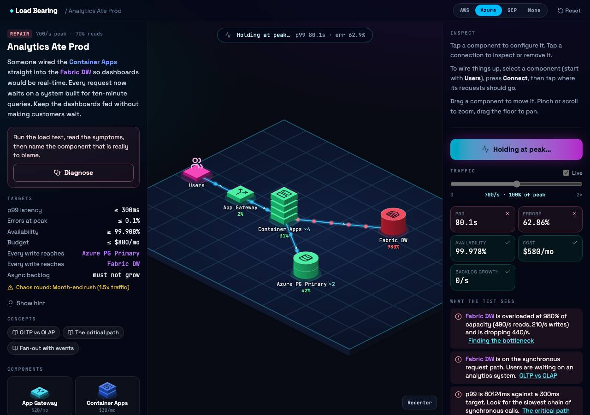
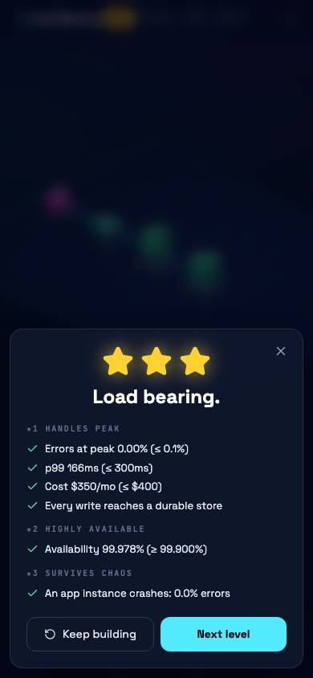

<h1 align="center">Architech</h1>

<p align="center">
  <strong>A system design game.</strong><br>
  Draw an architecture, throw traffic at it, watch it break, fix it.
</p>

<p align="center">
  
</p>

## Modes

**Build.** You get a brief (500 requests a second, p99 under 300ms, 99.9% available, $400 a month) and a palette. Place components on an isometric board, wire them together, size each tier, then run the load test. Traffic ramps to peak, then a chaos round fires: an instance crashes, a cache restarts cold, a whole availability zone goes dark.

**CAP trade-offs.** Five build levels where the chaos round is a network split: every machine stays up, but copies of the data can't reach each other. Each store gets a choice in the sidebar, refuse (consistent) or keep serving (available), and the right answer depends on the data: a payments ledger, a shopping basket, like counts, unique usernames. The same shelf adds sharding: set a SQL database's shard count and pick its partition key from the scenario's options, then watch for the key that piles every write onto one shard or sends every read to all of them. A sharded store is drawn sliced, with the busiest shard in its own colour.

**Production incidents.** Five build levels whose chaos round is the kind of failure a load test never shows, and that only the production settings survive: a payment provider that slows to five seconds a call (timeouts, backoff, idempotency keys, charging behind a queue), corrupt files that crash the converter every time (a dead-letter queue), credential stuffing at four times normal traffic and an unsigned probe (a rate limit at the edge, a sign-in check), a migration that deletes a column (point-in-time recovery against a 15-minute RPO), and workers that hang without crashing (an alert on the queue's age).

**Repair.** You inherit somebody else's production system and it's on fire. Load test it, read the symptoms, tap the component you think is really to blame, then fix it. Getting the diagnosis right first time earns a badge.

**Discussion decks.** Every scenario has a deck of 20 to 25 interview prompts: clarifying questions to open with, critical decisions, trade-offs, alternatives, scale, edge cases, failure and recovery (at least two per deck), security, observability and product. Answer out loud, flip to see what a strong answer covers and where an interviewer pushes next, then mark it got it or revisit.

**Survival.** An arcade mode: keep one architecture alive through endless waves. Traffic grows about 30% a wave, the mix shifts between browsing surges, checkout rushes and floods of slow jobs, and from wave 3 a random disaster hits (a crash, a zone outage, a cold cache, a failed database, a traffic spike). Your budget grows each wave; you have three lives. Waves are seeded, and tests pin the balance: a sensible design reaches wave 10 or more, and a starter stack dies within a few waves.

**Retention.** A third mode for revision. Every deck card, quiz question and passed scenario you've met goes on a spaced schedule: things you know come back after 3, 7, 14, then 30 days; things you missed come back tomorrow. Passed scenarios come back after a week, to rebuild from an empty board.

**Points.** 1 per new flash card, 2 per newly correct quiz answer, 50 per scenario passed. In Retention, a right answer earns 1, or 2 if you'd missed it before, and a scenario revisit earns 25. First-time awards are given once, so retrying can't farm them.

**Achievements and ranks.** Thirteen achievements (20 points each), from "It's alive" to "Unbreakable" (wave 10 in Survival) and "Polyglot" (pass levels under all four naming schemes). Points carry you from Intern to Distinguished Architect. Achievements are derived from saved progress, so ones you'd already earned are granted on first load.

Each level is worth three stars: **handles peak** (errors, latency, budget, data actually stored), **highly available** (the topology's availability arithmetic), and **survives chaos, production-ready**. The third star also needs the production settings a load test can't see, set in each component's sidebar: backups (daily, or to the minute where money moves), encryption at rest for personal data, sign-in checks, a rate limit where traffic lands, timeouts and retries with backoff, dead-letter queues, idempotency keys for payments, and alerts. What's expected depends on what the system has at stake, and a missing one is named in the findings.

## Provider toggle

The **AWS / Azure / GCP / None** switch renames every component everywhere: the board, the palette, briefs, findings and the codex. "None" uses the vendor-neutral textbook name you'd use on an interview whiteboard (In-Memory Key-Value Cache, Message Queue, Event Log). Names were checked against provider docs in October 2026; see `src/providers/names.ts`.

## What it teaches

Eight build levels, seven interview classics, five CAP trade-off levels, five production incidents and six repair levels. The classics are the questions interviewers ask most: a URL shortener, group chat, a home timeline, a ticket sale, video streaming, ride hailing and search autocomplete. Together they cover horizontal scaling and N+1 capacity, cache-aside and cold-cache stampedes, read replicas and read/write splitting, CDNs and object storage, queues vs event logs, competing consumers and backlog, availability zones, standbys, OLTP vs OLAP, rate-limited OCR APIs behind a queue, micro-caching fast-changing data at the edge, partitioning write-heavy data, fan-out on write, waiting rooms for contended inventory, ephemeral state kept in memory, latency budgets, the CAP theorem and PACELC, quorums, merging conflicting writes, partition keys, hot keys and scatter-gather reads. The **Codex** has a card for every component and concept, each with what an interviewer is listening for.

## How the simulation works

`simulate()` in `src/sim/simulate.ts` is a pure function from a graph and a load profile to per-component metrics. The model is adapted from [architecture-simulator](https://github.com/TimmDay/architecture-simulator):

- **Routers divide, callers duplicate.** A load balancer splits 400 rps between its targets; an app server makes each of its calls per request.
- **Caches pass only misses** (and all writes) to what's behind them. The hit rate comes from the scenario, never from the player.
- **Reads and writes have separate capacity.** A replica serves reads and refuses writes; a SQL primary's extra instances are standbys, not capacity.
- **Latency climbs with utilisation** as 1 / (1 - ρ), capped. The p99 is the slowest synchronous path carrying at least 1% of requests.
- **Async hand-offs** take everything behind them off the critical path. Slow consumers grow a backlog instead of failing requests.
- **Availability** multiplies along the path and composes as 1 - (1 - a)^n across independent failure domains.

The canvas only displays this output: packet rate per edge, block colour by utilisation, red packets bursting at overloaded targets.

Every level ships a reference solution, and CI fails if a tuning change leaves any level unwinnable or any repair level already fixed.

<p align="center">
  
</p>

## Play it

**[tim-game-architech.firebaseapp.com](https://tim-game-architech.firebaseapp.com)**, deployed from `main` by GitHub Actions to Firebase Hosting. Each pull request gets its own preview link; sign-in only works on the live site, since previews' domains aren't on Firebase Auth's allow-list.

## Run it

```bash
pnpm install
pnpm dev          # http://localhost:5173
pnpm check        # lint + typecheck
pnpm test:run     # unit tests
pnpm build        # production build with the service worker
pnpm preview      # serve the build: the only way to test the PWA offline
```

It's a PWA: open it on a phone and use "Add to Home Screen". After the first visit it works offline. Progress, builds and the provider choice live in `localStorage`.

## Stack

Vite · React 19 · TypeScript (strict, `noUncheckedIndexedAccess`) · Tailwind v4 · hand-drawn isometric SVG · vite-plugin-pwa · vitest. No backend.

## Licence

MIT.
